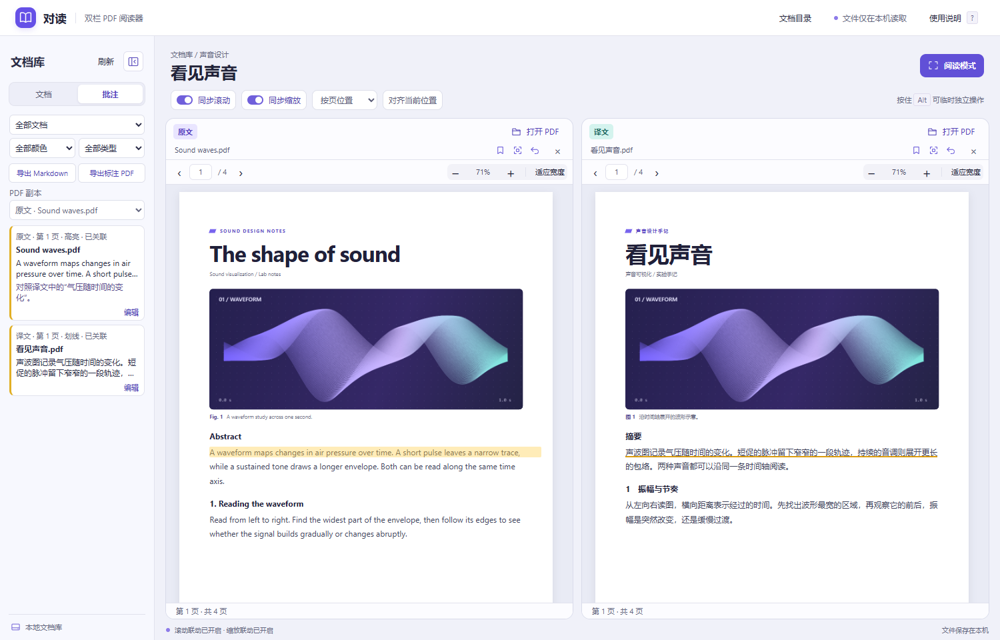
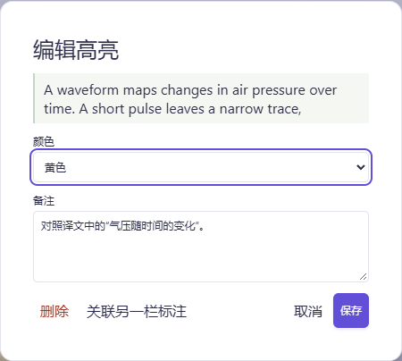
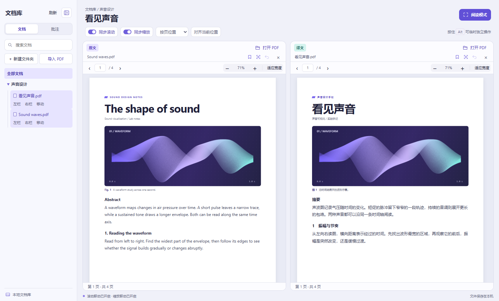

# Parallel Reader · 对读

Read original and translated PDFs side by side. Link matching passages and return to both with one click.

  

[简体中文](README.md) · **English** · [Installation](#install)

[Watch the one-minute demo by Gemini](media/parallel-reader-demo.mp4) · [Download for Windows](https://github.com/taijun123/parallel-reader/releases/latest)

**Parallel Reader (对读)** is a local-first Windows desktop application for reading, comparing, and annotating two PDFs side by side.

Open an original paper in the left pane and its translation (or a revised draft) in the right pane. Scroll and zoom them in sync, realign them on the fly when layouts diverge, and **link an annotation in the original text directly to its corresponding passage in the translation**. Reading, annotating, and linking passages work offline in the desktop app.



## Page 6 in the original, page 9 in the translation

When reading a paper alongside its translation, page numbers and paragraph layouts rarely match 1:1. Days later, when you review your highlights, it is tedious to hunt down where the matching sentence was in the other file.

To link those two passages:

1. Suppose you underline *working memory* on **page 6** of the original PDF and want to remember how the translator rendered it on **page 9** of the translated PDF.
2. Click the underline, choose **关联另一栏标注 (Link mark in the other pane)**, and highlight or select the translated phrase in the other pane.
3. Next time you click that linked entry in the **批注 (Annotations)** sidebar, **the left pane jumps to page 6 and the right pane simultaneously jumps to page 9**. (Clicking a normal, unlinked annotation moves only its own pane so you never lose your place in the other document.)



## Key Features

- **Flexible Dual-Pane Sync & Re-Alignment**
  - Toggle **scroll sync** and **zoom sync** (`25%`–`400%` or Fit Width) independently.
  - Switch between **By Page Position** and **By Document Progress** sync modes.
  - **Align Current Position (`对齐当前位置`)**: When two PDFs have different page counts or formatting, scroll each pane to a matching paragraph and lock in a new sync anchor with one click.
  - Hold `Alt` to scroll or zoom a single pane temporarily without turning off global sync.
  - Enter **Reading Mode (`阅读模式`)** to hide toolbars and sidebars for distraction-free reading (`Esc` to exit).
- **Rich Annotations & Cross-Pane Linking**
  - Highlight text, underline passages, attach text notes, draw **rectangle region marks** over figures or scanned pages, and bookmark full pages (`Ctrl + Z` to undo).
  - Open two different PDFs and manually pair a mark in one pane with a mark in the other. With both documents open, a linked entry takes you to both passages.
  - Filter annotations by document, color, or mark type in the sidebar.
- **Local-First Library & Content-Addressed Storage**
  - Organize PDFs into nested local folders, import several at once, or move them between folders. The limit is 500 MiB per file.
  - The local database (`.parallel-reader.sqlite`) identifies each PDF by its SHA-256 content hash. Moving the same file between library folders preserves its annotations. A regenerated PDF with a different hash is treated as a separate document.
  - Supports opening and annotating password-protected (encrypted) PDFs.



- **Structured Exports**
  - **Markdown Export**: Keeps linked original excerpts, translated excerpts, and your personal notes grouped together in clean Markdown blocks.
  - **Annotated PDF Copy**: Save an annotated copy of either PDF without altering the original file. For encrypted PDFs, Markdown is the available annotation export format.

## Keyboard shortcuts

| Shortcut | Action |
| --- | --- |
| Hold `Alt` while scrolling or zooming | Adjust only the active pane while sync is enabled |
| `Ctrl` + mouse wheel | Zoom the active pane, or both panes when zoom sync is enabled |
| `Ctrl+Z` | Undo the last annotation action |
| `Esc` | Exit Reading Mode |

<a id="install"></a>

## Install on Windows

The x64 installers target **Windows 10 22H2** and **Windows 11** on Intel or AMD processors. Both installers bundle the required Node.js runtime. Installation has been verified on Windows 11 x64. Installation on a clean Windows 10 system without WebView2 has not yet been tested. The application interface is in Simplified Chinese.

| Installer | When to use it | Size |
| :--- | :--- | ---: |
| **`ParallelReader-Offline-Setup-x64.exe`** | **For a new PC or offline environments.** Includes Microsoft's official WebView2 Evergreen x64 offline installer and installs it automatically if needed | ~253 MB |
| **`ParallelReader-Setup-x64.exe`** | **Lightweight installer** for PCs that already have a recent Microsoft Edge WebView2 Runtime installed | ~37 MB |

After installation, launch **对读 PDF 阅读器** from the Start menu, create or select a folder in the library, import your PDFs, and click **左栏** (Left Pane) and **右栏** (Right Pane) to start reading side by side.

## Back Up Your Library

Close the application and copy the entire library folder. It contains both your PDF files and the `.parallel-reader.sqlite` database that stores all annotations, bookmarks, and cross-document links.

## Run from source

From the project root with Node.js 24 installed:

```powershell
npm ci
npm run dev
```

Stop the development server with `Ctrl+C` before building and running the browser tests. The default test configuration uses a local Chrome installation.

```powershell
npm run build
npm test
```

After building, double-click `start.cmd` to run the local reader at `http://127.0.0.1:4173`.

## Built With & Acknowledgments

- [Mozilla PDF.js](https://mozilla.github.io/pdf.js/) (Apache-2.0) for PDF rendering
- [pdf-lib](https://pdf-lib.js.org/) (MIT) for standalone annotated PDF export
- Microsoft Edge WebView2 & Node.js for the local desktop runtime
- See `THIRD_PARTY_NOTICES.txt` for full third-party license details.
