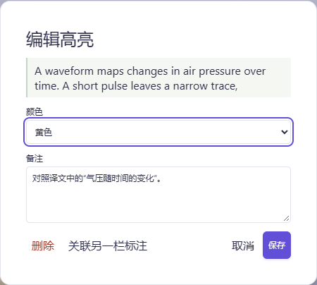
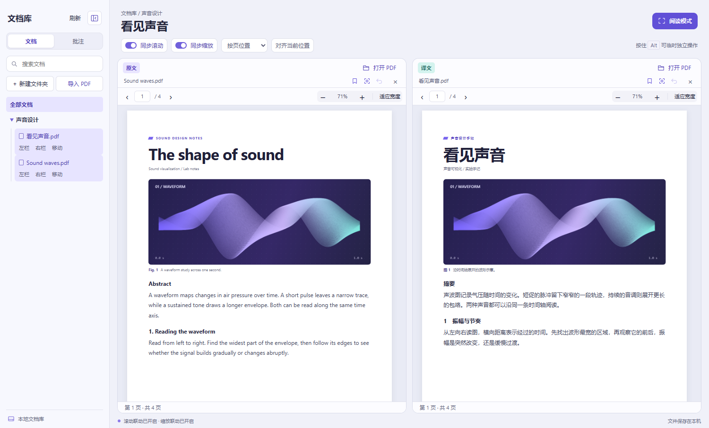

# 对读 · Parallel Reader

让原文与译文一起读。两栏排版可以手动对齐，对应段落可以成对批注。

  

**简体中文** · [English](README.en.md) · [安装与下载](#install)

[观看一分钟演示（Gemini 制作）](media/parallel-reader-demo.mp4) · [下载 Windows 安装包](https://github.com/taijun123/parallel-reader/releases/latest)

**对读 (Parallel Reader)** 是一款专为**外文文献精读、译本核对、两个版本并排校对**设计的 Windows 桌面双栏 PDF 阅读器。

把论文原文放在左栏、译文放在右栏，不仅能同步滚动与缩放，还能在两份文档页码/排版不一致时随时**手动重对齐**；遇到关键段落，可以把左栏原句和右栏译句**标成一对关联批注**，下次点击一条记录即可让左右两栏同时跳回对应位置。桌面应用在本机读取 PDF、保存批注，阅读和关联段落都可以离线完成。


## 原文在第 6 页，译文在第 9 页

双栏阅读最常见的问题是：**原文和译文的页数不同、排版错位，过几天再回头看笔记时，找得到原文却找不到当时对照的译文。**

试着给这两处文字做一对标记。

1. 你在左栏第 6 页给原文的 *working memory* 画了下划线，想记住译者在第 9 页将它译为“工作记忆”。
2. 点开这条标记，选择 **“关联另一栏标注”**，再到右栏译文中标出“工作记忆”（或直接点选已有批注），两处就建立了双向关联。
3. 下次在左侧 **“批注”** 清单中点击这条记录，**左栏会自动跳到第 6 页，右栏同时跳到第 9 页**。而点击未关联的普通批注时，只会定位它所在的那一栏，不会打乱另一栏当前的阅读位置。



## 核心特性

### 1. 灵活的双栏联动与错位对齐

- **独立同步开关**：**同步滚动**与**同步缩放**（`25%`–`400%` 或“适应宽度”）分别独立控制。
- **两种滚动映射模式**：支持 **按页位置**（跟随页内位置）与 **按全文进度**（按整篇文档百分比比例联动）切换。
- **错位排版一键对齐**：当原文与译文页码或排版不同步时，先将两栏滚到对应的段落，点击 **“对齐当前位置”**，即可从该锚点继续同步滚动。
- **单栏临时微调**：联动开启时，按住 `Alt` 键滚动或缩放，可临时单独操作其中一栏。
- **专注阅读模式**：一键收起顶部栏、侧边栏与工具条，最大化双栏阅读视野（按 `Esc` 即可恢复）。

### 2. 文字、图表批注与跨栏原译关联

- **多类型标注**：选中文字即可**高亮**、**下划线**或**添加笔记**；针对扫描版 PDF、公式与插图，支持使用**矩形区域标注**框选；支持整页**书签**标记。
- **跨栏批注配对**：在两栏各打开一份不同的 PDF，手动把两处批注配成一对。两份文档都打开时，可以从清单同时跳回两处，也可以把这对摘录一起导出。
- **批注筛选**：在左侧“批注”面板中，可按**所属文档、标记颜色、标注类型**快速过滤，支持 `Ctrl + Z` 撤销最近一次批注操作。

### 3. 本地文档库与批注存储

- **多级文件夹管理**：内置本地文档库，支持创建多级目录、批量导入（单文件上限 500 MiB）、拖拽打开与库内移动整理。
- **基于内容指纹绑定**：批注与原译关联保存在本地 SQLite 数据库（`.parallel-reader.sqlite`）中，并按文件内容的 SHA-256 指纹识别文档。在库内移动同一份 PDF 后可以继续查看批注。重新生成的 PDF 如果内容指纹改变，会被当作另一份文档。
- **支持加密 PDF**：支持输入密码打开受保护的 PDF 文档并进行批注。



### 4. 带走你的阅读成果

- **原译成对导出 Markdown**：导出 Markdown 笔记时，已关联的**原句摘录、译句摘录与个人批注**会自动组合在同一条目下，可作为 Markdown 文件保存到笔记库。
- **另存为带批注的 PDF 副本**：可将单份文档连同高亮、划线、框选导出为新的带批注 PDF 文件，原 PDF 保留。加密 PDF 的批注可导出为 Markdown，暂不支持另存为带批注的 PDF。

## 快捷键与操作速查

| 操作 | 说明 |
| :--- | :--- |
| `按住 Alt` + 滚轮 / 缩放 | 在开启同步时，临时单独滚动或缩放当前栏 |
| `Ctrl` + 滚轮 | 缩放阅读页面（联动开启时双栏同步缩放） |
| `Ctrl + Z` | 撤销最近一次批注操作 |
| `Esc` | 退出专注阅读模式 |

<a id="install"></a>

## Windows 安装与快速开始

面向 Intel / AMD x64 架构电脑，目标系统为 **Windows 10 22H2** 与 **Windows 11**。两种安装包均内置 Node.js，可按下表选择。已在 Windows 11 x64 验证安装；尚未在缺少 WebView2 的全新 Windows 10 环境实测。

| 安装包文件 | 适用场景 | 体积 |
| :--- | :--- | ---: |
| **`ParallelReader-Offline-Setup-x64.exe`** | **推荐新电脑或离线环境使用**。内置微软官方签名的 Edge WebView2 Runtime 离线安装程序，缺省或版本过低时自动补装 | 约 253 MB |
| **`ParallelReader-Setup-x64.exe`** | **轻量版**。适合系统已安装较新 Microsoft Edge WebView2 Runtime 的 Windows 10/11 电脑 | 约 37 MB |

**三步开始对读**

1. 安装后从开始菜单打开 **“对读 PDF 阅读器”**。
2. 在左侧文档库新建或选择文件夹，点击 **“导入 PDF”**（或直接将 PDF 拖入左右阅读区）。
3. 分别点击文件旁的 **“左栏”** 和 **“右栏”**，即可开始并排对读与批注。

## 数据备份与迁移

关闭阅读器后，直接复制整个文档库文件夹（`library/`）即可。你导入的所有 PDF 文件以及存放批注、书签和跨栏关联关系的 `.parallel-reader.sqlite` 数据库都在该目录内，迁移时请把它们一起复制到新电脑的文档库中。

## 从源码运行

如果你希望在浏览器中使用网页版或参与二次开发（需安装 Node.js 24+）：

```powershell
# 安装依赖
npm ci

# 启动开发服务器，按 Ctrl+C 停止后继续
npm run dev

# 构建生产包
npm run build

# 运行端到端测试（默认使用本机 Chrome）
npm test
```

构建完成后，也可以双击工程目录下的 `start.cmd` 启动本地服务（默认访问 `http://127.0.0.1:4173`）。

## 技术与致谢

对读使用 Mozilla PDF.js 渲染 PDF，使用 pdf-lib 写入导出副本的批注。Windows 桌面窗口由 Microsoft Edge WebView2 提供，本地服务运行在 Node.js 上。第三方许可见源码中的 `THIRD_PARTY_NOTICES.txt`。[PDF.js](https://mozilla.github.io/pdf.js/) · [pdf-lib](https://pdf-lib.js.org/)
